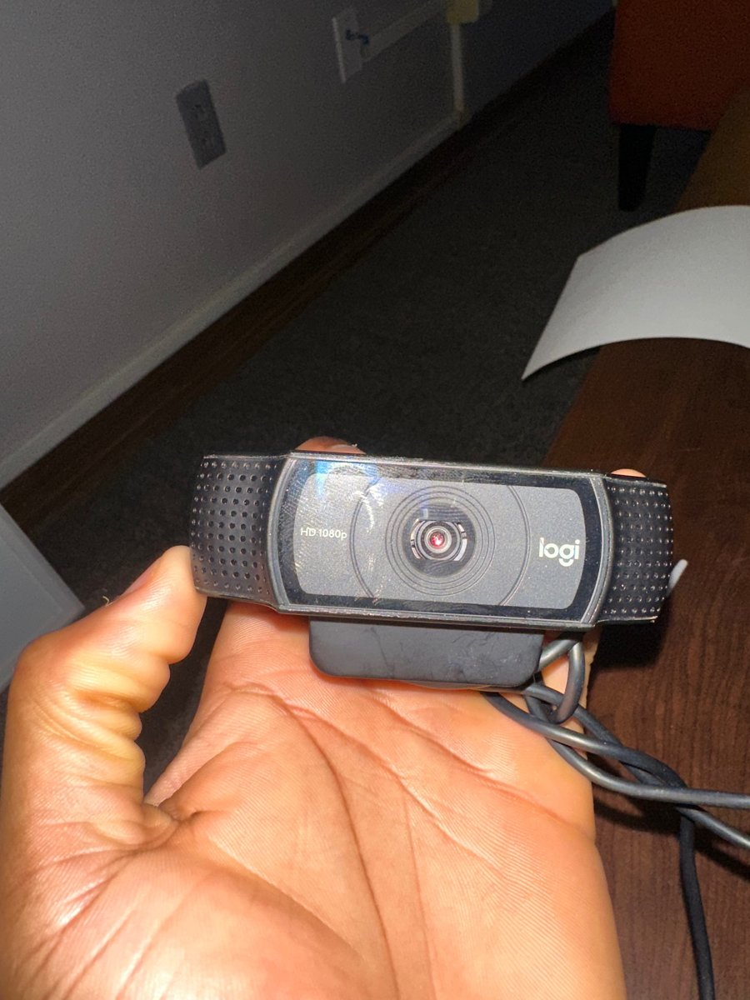

# wifidar devlog

Running notes while I build wifidar, an ESP32 that treats Wi-Fi like a robot sensor, with Foxglove as two-way mission control.

Each entry covers what I built, why, what broke, and what I learned. I update this right after each step so it stays honest.

---

## Step 1: Repo setup

Made the repo with a folder for every part of the project:

| Folder | What's in it |
|---|---|
| `firmware/` | code that runs on the ESP32 |
| `bridge/` | Python program that connects the ESP32 to Foxglove |
| `extension/` | Signal Hunter, my custom Foxglove panel |
| `foxglove/` | exported Foxglove layout |
| `recordings/` | a sample recording people can replay |
| `docs/` | this log and images |

The `.gitignore` skips anything generated or downloaded (venv, node_modules, build output) and every `.mcap` recording except one sample I'll ship on purpose.

Named it **wifidar**, Wi-Fi + lidar/radar, since the whole idea is using Wi-Fi the way a robot uses lidar.

---

## Step 2: Bridge skeleton + fake ESP32

Before touching any hardware, I built a fake ESP32 in Python.

It has the same `readline()`, `write()` and `close()` methods as a real serial port, and it sends the exact same JSON lines the real firmware will. So the bridge can't tell if it's talking to the real board or the fake one. Signals drift with a sine wave plus some random noise, so it feels like walking around a building.

The bridge just reads lines and prints a table for now.

**Learned:** building a mock first means I can build and test the whole laptop side without waiting on hardware. When the real board is ready, I swap one line.

---

## Step 3: Streaming to Foxglove

The bridge now runs a Foxglove WebSocket server and publishes:

- `/wifi/scan`: every network from the latest scan, strongest first
- `/log`: readable events for Foxglove's Log panel

Something that threw me at first: **the bridge is the server and Foxglove connects to it**, not the other way around.

**Privacy.** A Wi-Fi scan picks up everyone's networks, not just mine. Once data goes into Foxglove it ends up in recordings and demo videos, so I didn't want my neighbors' network names or hardware addresses in there. The bridge hashes every BSSID into a short ID like `net-3fa2c1` and only shows real names for networks I list as mine. Nothing identifying about anyone else leaves the bridge.

**Plotting.** Used Foxglove's message path filters to plot only my own network:

```
/wifi/scan.networks[:]{mine==true}.rssi
```

That reads as: go into `networks`, look at every item, keep the ones where `mine` is true, plot their `rssi`.


**Bug: the Log panel was empty.** The bridge sends a hello message right when it starts, which is *before* Foxglove connects. Live viewers only get messages sent after they subscribe, so the hello was already gone.

**Fix:** a listener that notices when a Foxglove app subscribes to `/log` and resends the latest status. The SDK calls the listener on its own thread, so the listener only flips a flag (`threading.Event`) and the main loop does the actual logging. That keeps all the work on one thread.

**Learned:** live streaming and recording are different. Live viewers miss anything sent before they show up. A recording won't have that problem.

---

## Design note: adding a camera (planned)



While testing Step 3, I had a Logitech C920 webcam sitting next to me and started thinking about what real robots do. They don't just log sensor numbers. They put cameras right next to the sensors, so when something weird shows up in the data, you can see what the robot actually saw at that moment.

Foxglove already lines up every topic by timestamp, so if I add a camera topic, scrubbing through a recording would show the radar, the plots, and the camera frame all from the same instant. No extra syncing on my end.

Planned topics:

| Topic | What it is |
|---|---|
| `/camera/webcam` | frames from the C920, compressed to JPEG |
| `/esp32/screen` | an image of what the ESP32's screen was showing |

**Fake webcam.** Same idea as the fake ESP32: a `FakeWebcam` with the same interface as the real camera, so I can test the whole pipeline without the camera plugged in. My plan for the fake feed is a fixed standard image at a set size where only a few things change each frame: a frame counter, a timestamp, and a dot moving in a circle. Since it's deterministic, frame 120 always looks the same, so if something's off (dropped frames, lag, wrong timing) I'll see it right away. It lets me test what a real camera setup would be like before the real camera is involved.

**The ESP32 screen.** My first idea was to send the actual display buffer from the ESP32. Then I did the math:

- 240 x 240 pixels x 2 bytes = about **115 KB per frame**
- over serial at 115200 baud, that's about 11.5 KB per second
- so roughly **10 seconds per frame**

Way too slow. And the display library draws straight to the screen without keeping a copy in memory anyway.

Better plan: a **digital twin**. Everything the screen shows (mode, network count, dBm, percent, label) is data the bridge already has. So the bridge can redraw the same screen in Python and publish it. No extra serial traffic, it works with the fake ESP32, and it always matches the real screen. Streaming the real framebuffer could be a stretch goal later.

**Privacy again:** if I record walks with the webcam, I'll catch other people. I'll keep the camera pointed at my hand and the ESP32, or blur faces, before anything goes in the repo.

---

## Roadmap

| # | Step | Status |
|---|---|---|
| 1 | Repo setup | done |
| 2 | Bridge skeleton + fake ESP32 | done |
| 3 | Streaming to Foxglove | done |
| 4 | 3D radar | next |
| 5 | Recording + replay (MCAP) | |
| 6 | Camera: fake webcam, then the real C920 | |
| 7 | ESP32 screen twin | |
| 8 | Signal Hunter panel | |
| 9 | Two-way commands | |
| 10 | Firmware on the real ESP32 | |
| 11 | Swap in real hardware | |
| 12 | README, demo, write-up | |
