# wifidar devlog

Running notes while I build wifidar, an ESP32 that treats Wi-Fi like a robot sensor, with Foxglove as two-way mission control.

Each entry covers what I built, why, what broke, and what I learned. I update this right after each step so it stays honest.

---

## Step 1: Repo setup

Made the repo with a folder for every part of the project:

| Folder | What's in it |
|---|---|
| `firmware/` | code that runs on the ESP32 |
| `bridge/` | Python program that connects the ESP32 to Foxglove |
| `extension/` | Signal Hunter, my custom Foxglove panel |
| `foxglove/` | exported Foxglove layout |
| `recordings/` | a sample recording people can replay |
| `docs/` | this log and images |

The `.gitignore` skips anything generated or downloaded (venv, node_modules, build output) and every `.mcap` recording except one sample I'll ship on purpose.

Named it **wifidar**, Wi-Fi + lidar/radar, since the whole idea is using Wi-Fi the way a robot uses lidar.

---

## Step 2: Bridge skeleton + fake ESP32

Before touching any hardware, I built a fake ESP32 in Python.

It has the same `readline()`, `write()` and `close()` methods as a real serial port, and it sends the exact same JSON lines the real firmware will. So the bridge can't tell if it's talking to the real board or the fake one. Signals drift with a sine wave plus some random noise, so it feels like walking around a building.

The bridge just reads lines and prints a table for now.

**Learned:** building a mock first means I can build and test the whole laptop side without waiting on hardware. When the real board is ready, I swap one line.

---

## Step 3: Streaming to Foxglove

The bridge now runs a Foxglove WebSocket server and publishes:

- `/wifi/scan`: every network from the latest scan, strongest first
- `/log`: readable events for Foxglove's Log panel

Something that threw me at first: **the bridge is the server and Foxglove connects to it**, not the other way around.

**Privacy.** A Wi-Fi scan picks up everyone's networks, not just mine. Once data goes into Foxglove it ends up in recordings and demo videos, so I didn't want my neighbors' network names or hardware addresses in there. The bridge hashes every BSSID into a short ID like `net-3fa2c1` and only shows real names for networks I list as mine. Nothing identifying about anyone else leaves the bridge.

**Plotting.** Used Foxglove's message path filters to plot only my own network:

```
/wifi/scan.networks[:]{mine==true}.rssi
```

That reads as: go into `networks`, look at every item, keep the ones where `mine` is true, plot their `rssi`.

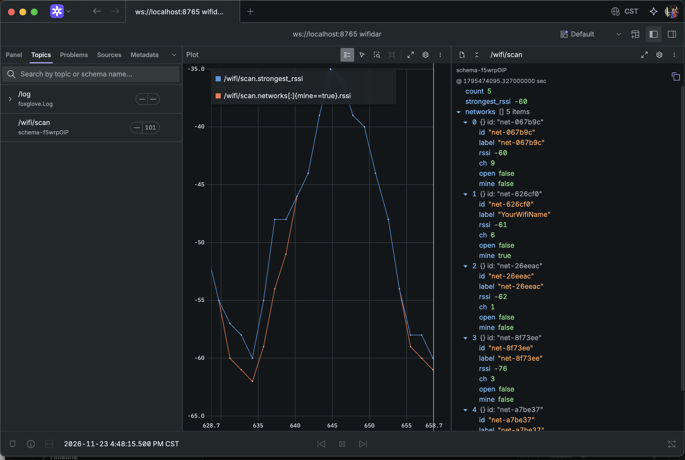

**Bug: the Log panel was empty.** The bridge sends a hello message right when it starts, which is *before* Foxglove connects. Live viewers only get messages sent after they subscribe, so the hello was already gone.

**Fix:** a listener that notices when a Foxglove app subscribes to `/log` and resends the latest status. The SDK calls the listener on its own thread, so the listener only flips a flag (`threading.Event`) and the main loop does the actual logging.

**Learned:** live streaming and recording are different. Live viewers miss anything sent before they show up. A recording won't have that problem.

---

## Step 4: 3D radar

Each scan now turns into a 3D radar in Foxglove's 3D panel. I'm a blue sphere in the middle, and each network is a bar around me:

- **which slice** of the circle = its Wi-Fi channel (1 to 13), so I can see which channels are crowded
- **distance from me** = signal strength, strong is close
- **height and color** = signal strength again, tall and green is strong, short and red is weak

Faint rings mark -50, -70 and -90 dBm.

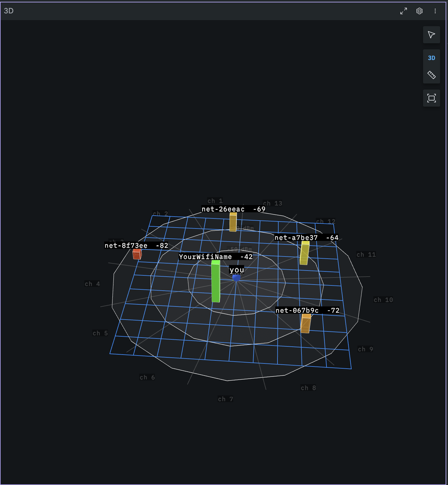

All the 3D math lives in its own file, `scene.py`, so the bridge just calls `build_scene()` and publishes the result as a `SceneUpdate`. Each network's bar has the same ID every scan, so Foxglove replaces it instead of stacking a new one. Bars also have a lifetime, so if a network stops showing up, its bar disappears on its own.

Placing things on a circle is just `x = distance * cos(angle)` and `y = distance * sin(angle)`. Each network's spot inside its slice comes from a hash of its ID, so it stays in the same place between scans instead of jumping around.

Had to learn coordinate frames for this. Every shape says which frame it lives in. Mine are `world` (the room) and `base` (me), plus a transform saying where `base` sits in `world`. Right now it's fixed at the center, but later the transform could actually rotate when I turn the board.

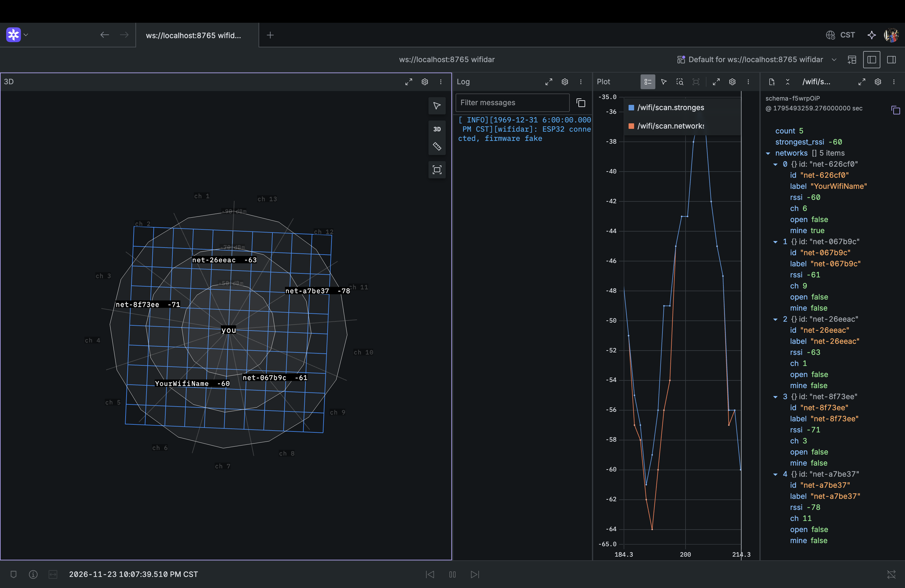

---

## Step 5: Recording + replay

The bridge now records every session to an MCAP file in `recordings/`, named with the date and time so nothing gets overwritten. Once the file is open, every `foxglove.log()` call goes live to Foxglove *and* into the file, so I didn't have to change any of my logging code.

Opening the file in Foxglove gives me a timeline. Dragging the scrubber moves the radar, the plot, and the raw messages to the same moment together. That's the part that makes the webcam idea work.

**Bug: logs from 1969.** The Log panel was showing every message at Dec 31, 1969, 6:00 PM. Foxglove's Log message has its own timestamp field and I never set it, so it defaulted to 0. Time 0 is the Unix epoch, midnight Jan 1, 1970 UTC, which is 6 PM Dec 31 in Central time. Fixed it by setting `timestamp=Timestamp.now()`.

**Bug: the bridge closed right away.** When I rewrote `main()`, the last two lines of the file got cut off:

```python
if __name__ == "__main__":
    main()
```

So Python defined `main()` but never called it, and the program just ended. Easy fix, but it taught me what that block actually does.

**Learned:** the MCAP index gets written when the file closes. If the program gets killed without closing it, the file can come out broken. That's why the close is in `finally`, and why I always stop with Ctrl+C.

<!-- TODO: add a screenshot of a replay with the timeline visible -->
<!--  -->

---

## Step 6: Camera

Added a camera topic, `/camera/webcam`, so recordings show what the camera saw at every moment next to the radar. Same pattern as the ESP32: a fake source and a real one with the same `read()` and `close()` methods, so the rest of the code can't tell them apart.

**Fake webcam.** This was the idea I wanted to test: a fixed standard image where only a few things change each frame. The grid, color bars, and circle get drawn once. Every frame just copies that and adds a dot moving around the circle, a frame counter, and a time label.

Everything is based on the frame number, not the clock, so frame 120 always looks exactly the same. When I step through a replay, the counter should go up by about 6 each time (30 camera frames per second, 5 published). If it jumps more than that, frames got dropped.

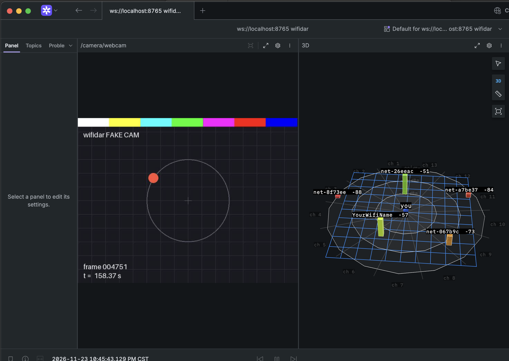

**Real camera.** Swapping to my Logitech C920 is one flag: `--camera webcam`. macOS asked for camera permission the first time. I pointed it at my laptop while Foxglove was open, so the feed shows Foxglove showing the feed, over and over.


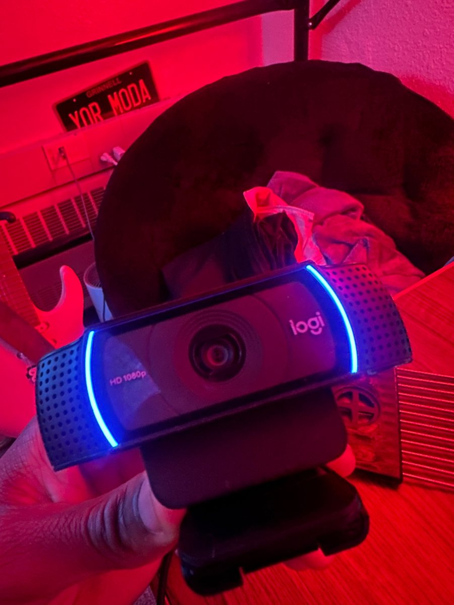

**Threads.** The main loop spends most of its time waiting on the ESP32, so the camera runs on its own thread. It reads every frame from the camera but only publishes 5 per second. Reading frames I throw away sounds wasteful, but webcams buffer frames, and if you read slower than the camera produces, you get old frames and the video lags behind.

Also learned not to name a thread attribute `_stop`, because `threading.Thread` already has an internal method with that name. Overwriting it breaks `join()`.

**JPEG.** A raw 640x480 frame is about 920 KB. As a JPEG it's around 20 to 60 KB. At 5 frames a second, that keeps recordings small enough to actually share.

**Shutdown order.** The camera thread stops *before* the recording closes. Otherwise it could try to write a frame into a file that's already closed.

**Bug: missing startup logs.** Only one startup line showed up in the Log panel. My Step 3 fix only remembered the *latest* status, so "Camera started" got replaced by "ESP32 connected" before Foxglove connected. Some startup lines were also plain `print()` calls that never went to Foxglove at all.

Fixed it with a `deque` that keeps the last 20 events. When a viewer subscribes to `/log`, the bridge resends all of them with their original timestamps. Resent copies are labeled `wifidar (resent)` because they also end up in the recording. I tested whether the SDK could send a message to just one viewer and skip the recording, and it couldn't, so labeling them was the honest option.

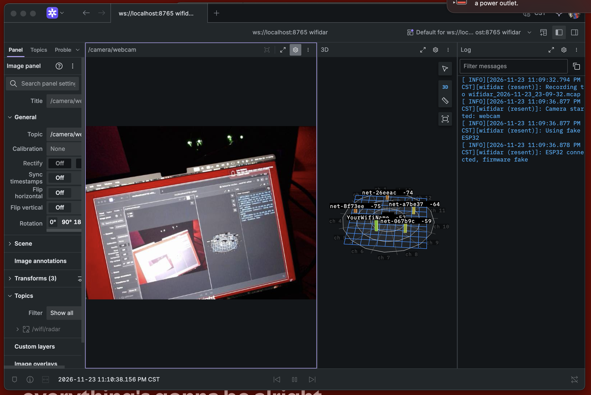

Also switched to logging just the recording's file name instead of the full path, so my home folder doesn't end up in recordings I share.

---

## Step 7: ESP32 screen twin

Added `/esp32/screen`, an image of what the ESP32's screen is showing at
each moment. My first idea was to send the real display buffer, but at
115200 baud that's about 10 seconds per frame. Everything the screen
shows (mode, network count, dBm, label) is data the bridge already has,
so the bridge redraws the screen itself in Python. That's a digital twin:
a software copy kept in sync with the real thing, with zero extra serial
traffic. It works with the fake ESP32 too.

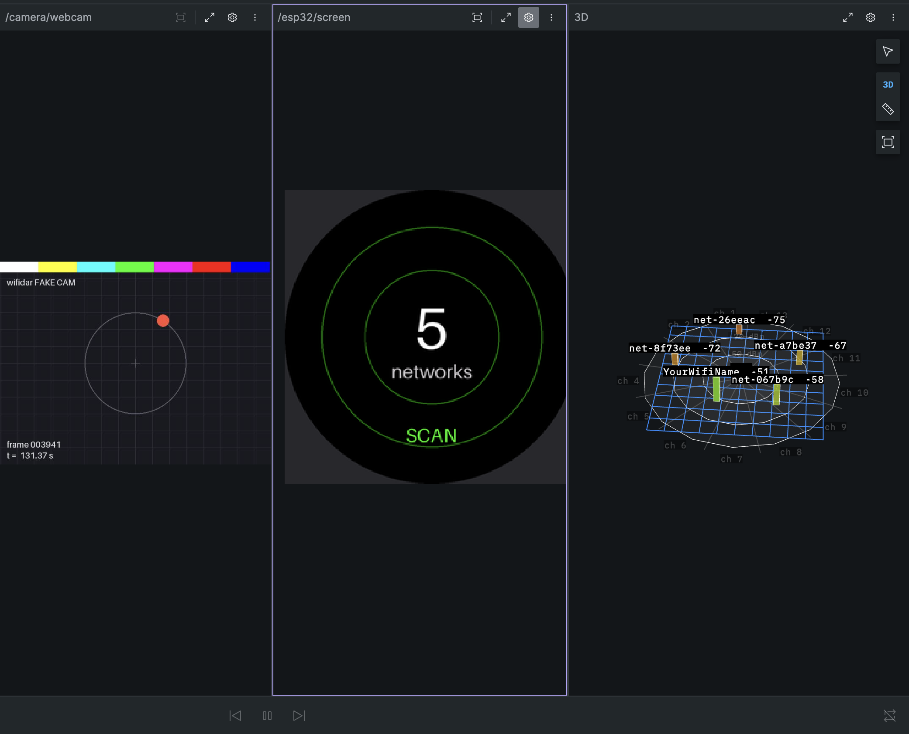

`screen.py` mirrors the firmware's two screens:

| Scan mode | Track mode |
|---|---|
| 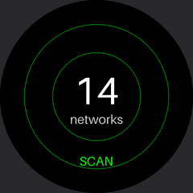 | 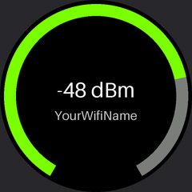 |

The scan screen shows radar rings and how many networks are around. The
finder screen has a ring that fills up and goes from red to green as I
get closer to the network I'm hunting. The rule for a digital twin is that
it has to change whenever the real thing changes, so the file says that
right at the top.

**Smooth edges.** Pillow draws jagged circles, so I draw everything at
3x size and shrink it down. Shrinking blends the jagged pixels into
smooth edges. This is called supersampling.

**Angles.** The firmware's arc angles start at the bottom of the circle,
but Pillow's start on the right. Both go clockwise, so converting is just
adding 90 degrees.

**PNG, not JPEG.** JPEG is great for camera photos, but it makes sharp
text and flat colors blotchy. The screen is all text and flat colors, so
PNG keeps it crisp, and each frame is only about 17 to 21 KB.

**Labels.** Tracking messages from the ESP32 only carry a BSSID, not a
name. The bridge already sees names during scans, so it keeps a lookup
table from ID to label. That's how the finder screen knows to say
"YourWifiName" instead of a hash. `/wifi/tracked` now includes the label
too, for the Signal Hunter panel.

**Testing it alone.** Running `python screen.py` by itself saves sample
images of both screens, so I can tweak the look without starting the
whole bridge. The finder screen can't show up live until the Track
button exists, so that's where the preview above came from.

Now a replay shows the radar, the camera, the plots, and what the ESP32's
screen was showing, all on the same timeline.

---

## Step 8: Signal Hunter panel

Built my own Foxglove panel, Signal Hunter, as an extension in TypeScript
and React. For now it reads `/wifi/scan` and shows every network as a
row, strongest first, with a strength bar. My own network is in bold.
Next step, each row gets a Track button.

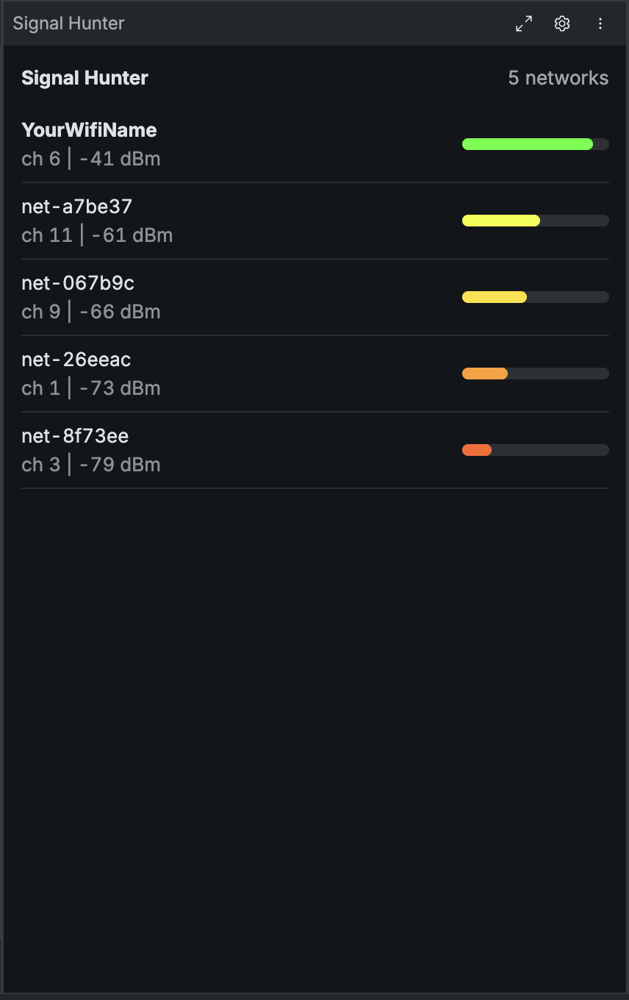

**How a panel gets data.** The panel subscribes to a topic, Foxglove
calls its `onRender()` function whenever new messages arrive, the panel
saves the newest scan in React state, and React redraws. Then the panel
calls `done()` to tell Foxglove it's ready for more. If you forget
`done()`, the panel freezes after the first update.

**Types as a contract.** The panel declares exactly what a scan message
looks like (`id`, `label`, `rssi`, `ch`, `open`, `mine`). That's the
contract between the Python bridge and the TypeScript panel. If I rename
a field in the bridge and update the type here, TypeScript points at
every line that needs to change. Python alone would never warn me.

**Consistent colors.** The panel uses the same strength math and the
same red, yellow, green colors as the 3D radar and the ESP32 screen
twin, so all three agree on what "strong" looks like.

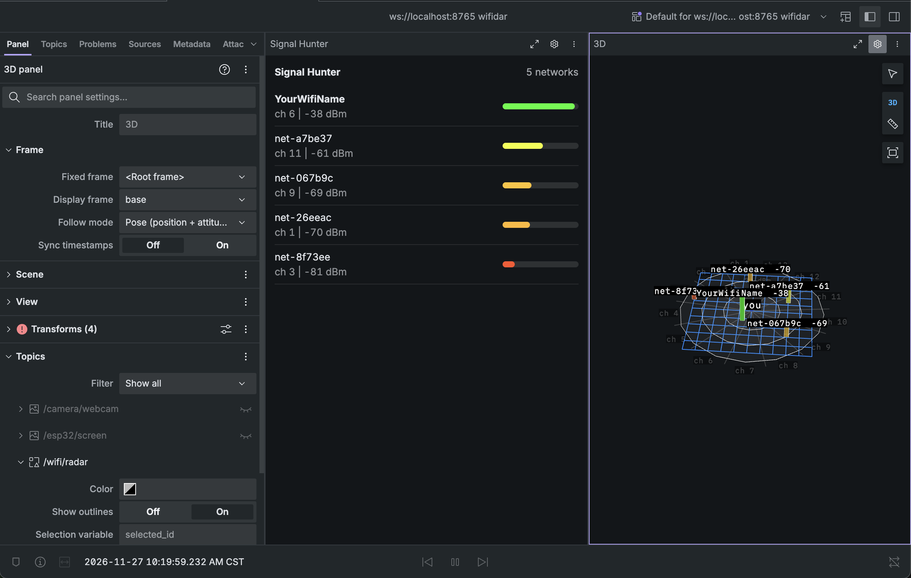

Because the panel just subscribes to a topic like Foxglove's built-in
panels do, it works on recordings too. Opening an old MCAP file replays
the list along with everything else.

**Small gotcha:** Foxglove only loads extensions when it starts, so
after every `npm run local-install` I have to fully quit (Cmd+Q) and
reopen it.

---

## Step 9: Two-way commands

This is the part that makes wifidar more than a dashboard. Data flows
*into* Foxglove, and now commands flow back *out* to the hardware.

Every network in Signal Hunter has a Track button. Clicking it sends a
command from Foxglove, through the bridge, down to the ESP32, which
switches into finder mode for that network. The screen twin switches to
the finder ring, and the panel turns into a live readout.

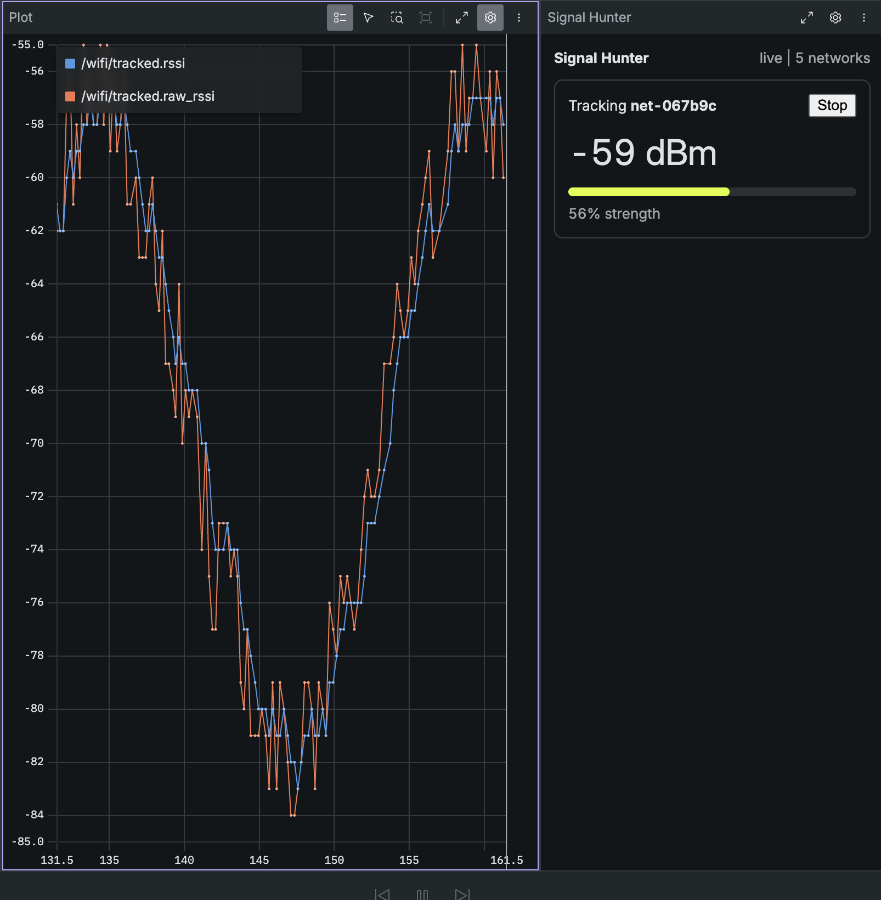

**The path of one click:**

1. Signal Hunter publishes `{"action": "track", "id": "net-067b9c"}`
   on `/esp32/cmd`
2. It goes over the WebSocket to the bridge
3. The SDK hands it to my listener on its own thread, which drops it
   in a queue
4. The main loop picks it up, looks up the real BSSID and channel, and
   writes `TRACK <bssid> <channel> <label>` to the ESP32

**Advertise, then publish.** Before a panel can send anything, it has
to advertise the topic. The bridge gets a numeric channel ID for it,
and every message after that only carries the ID. So the bridge keeps
a small table from channel ID to topic, and ignores anything that isn't
a command, so a stray message can't move the hardware.

**Privacy still holds.** The panel only ever knows private IDs like
`net-067b9c`. The real BSSID never leaves the bridge. It translates the
ID at the very last moment, right before writing to the serial port.

**Commands as a type.** In TypeScript, a command is either
`{action: "track", id}` or `{action: "stop"}`. That's a union type, so
the compiler won't let me send a track command without an ID or
misspell "stop."

**Replays can't send commands.** When I open a recording, Foxglove
doesn't give the panel an `advertise` function at all, since there's
nothing live to talk to. The panel checks for that, grays out the Track
buttons, and says "replay, tracking off." Every command also gets
logged to `/esp32/cmd_log`, so a replay shows exactly when I clicked.

**Raw vs. smoothed.** Plotting `/wifi/tracked.raw_rssi` next to
`/wifi/tracked.rssi` shows what the smoothing does. Raw Wi-Fi readings
jump a few dBm every reading. The smoothed line follows the trend
without the noise, just a little behind.

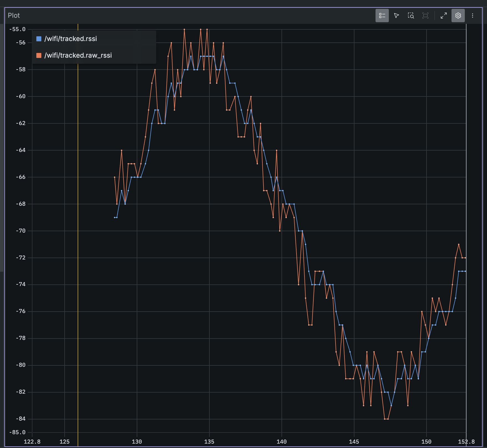

**Plot gotcha.** When there's a gap with no tracking data (like when I
stopped and started tracking again), the Plot panel draws a straight
line across it. That line isn't real data, it's just connecting the
dots, so I have to watch for it when reading plots.

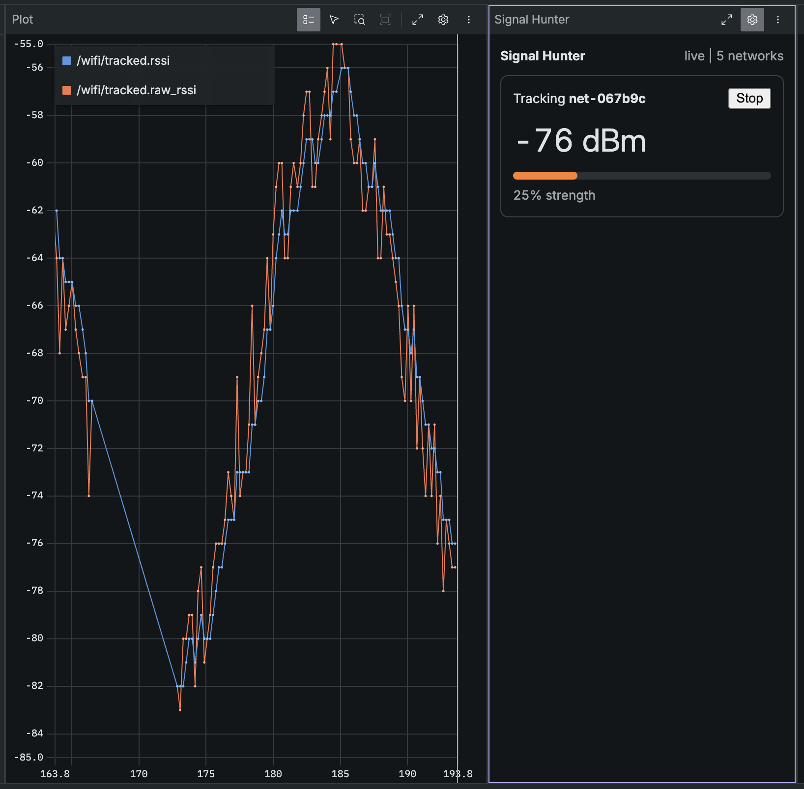

---

## Design note: adding a camera


While testing Step 3, I had a Logitech C920 webcam sitting next to me and started thinking about what real robots do. They don't just log sensor numbers. They put cameras right next to the sensors, so when something weird shows up in the data, you can see what the robot actually saw at that moment.

Foxglove already lines up every topic by timestamp, so if I add a camera topic, scrubbing through a recording would show the radar, the plots, and the camera frame all from the same instant. No extra syncing on my end.

| Topic | What it is |
|---|---|
| `/camera/webcam` | frames from the C920, compressed to JPEG (built in Step 6) |
| `/esp32/screen` | an image of what the ESP32's screen was showing (Step 7) |

**Fake webcam.** Same idea as the fake ESP32: a `FakeWebcam` with the same interface as the real camera, so I can test the whole pipeline without the camera plugged in. The fake feed is a fixed standard image at a set size where only a few things change each frame. Since it's deterministic, if something's off (dropped frames, lag, wrong timing) I'll see it right away. It lets me test what a real camera setup would be like before the real camera is involved.

**The ESP32 screen.** My first idea was to send the actual display buffer from the ESP32. Then I did the math:

- 240 x 240 pixels x 2 bytes = about **115 KB per frame**
- over serial at 115200 baud, that's about 11.5 KB per second
- so roughly **10 seconds per frame**

Way too slow. And the display library draws straight to the screen without keeping a copy in memory anyway.

Better plan: a **digital twin**. Everything the screen shows (mode, network count, dBm, percent, label) is data the bridge already has. So the bridge can redraw the same screen in Python and publish it. No extra serial traffic, it works with the fake ESP32, and it always matches the real screen. Streaming the real framebuffer could be a stretch goal later.

**Privacy:** if I record walks with the webcam, I'll catch other people. I'll keep the camera pointed at my hand and the ESP32, or blur faces, before anything goes in the repo.

---

## Roadmap

| # | Step | Status |
|---|---|---|
| 1 | Repo setup | done |
| 2 | Bridge skeleton + fake ESP32 | done |
| 3 | Streaming to Foxglove | done |
| 4 | 3D radar | done |
| 5 | Recording + replay (MCAP) | done |
| 6 | Camera: fake webcam, then the real C920 | done |
| 7 | ESP32 screen twin | done |
| 8 | Signal Hunter panel | done |
| 9 | Two-way commands | done |
| 10 | Firmware on the real ESP32 | next |
| 11 | Swap in real hardware | |
| 12 | Auto-tagged moments | |
| 13 | README, demo, write-up, registry PR | |