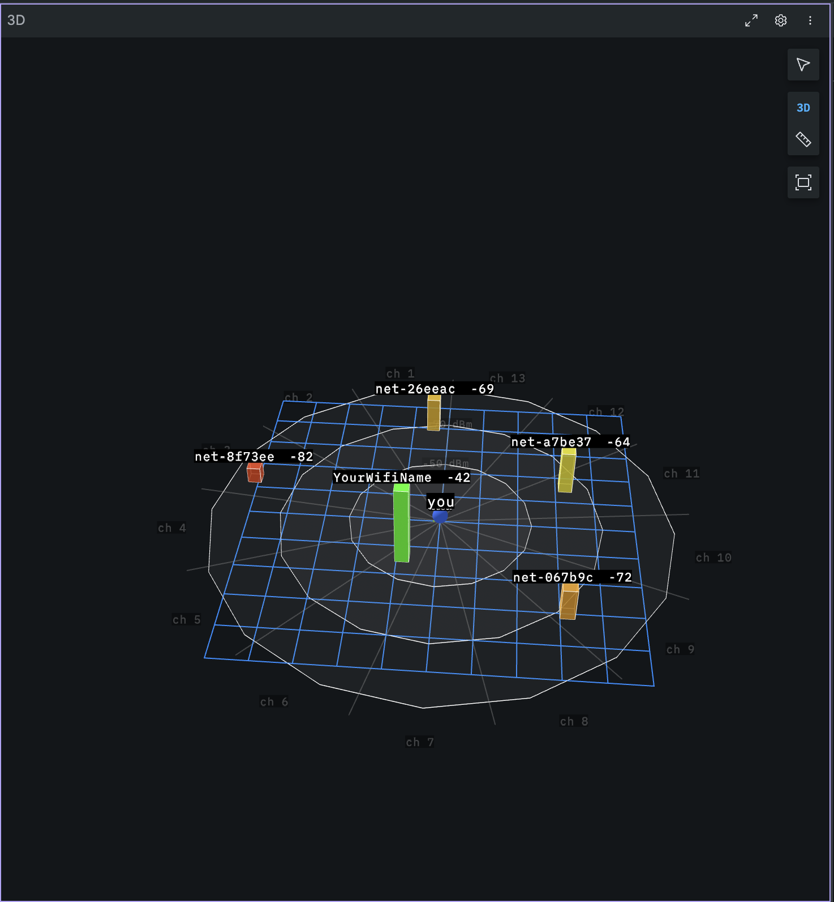
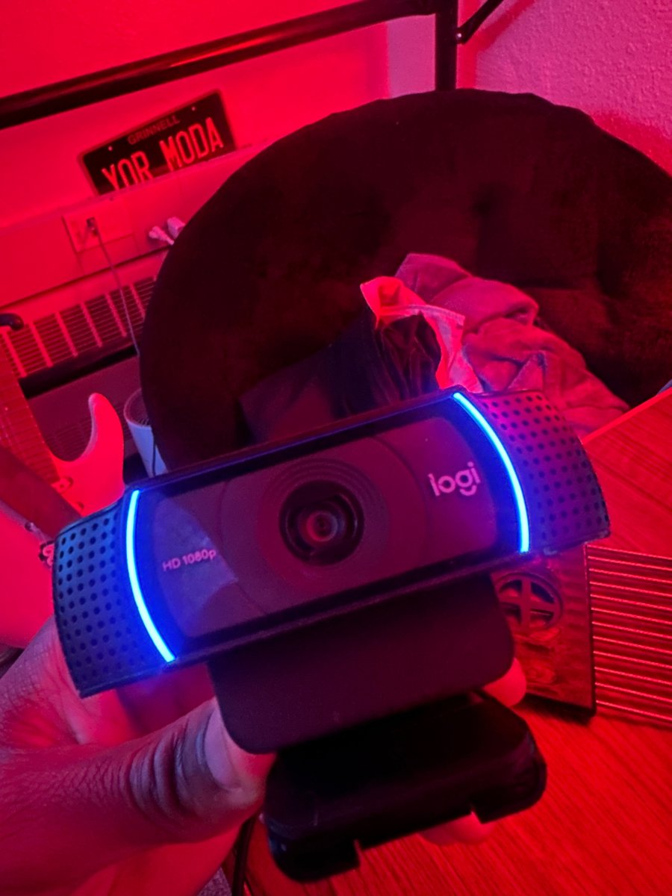
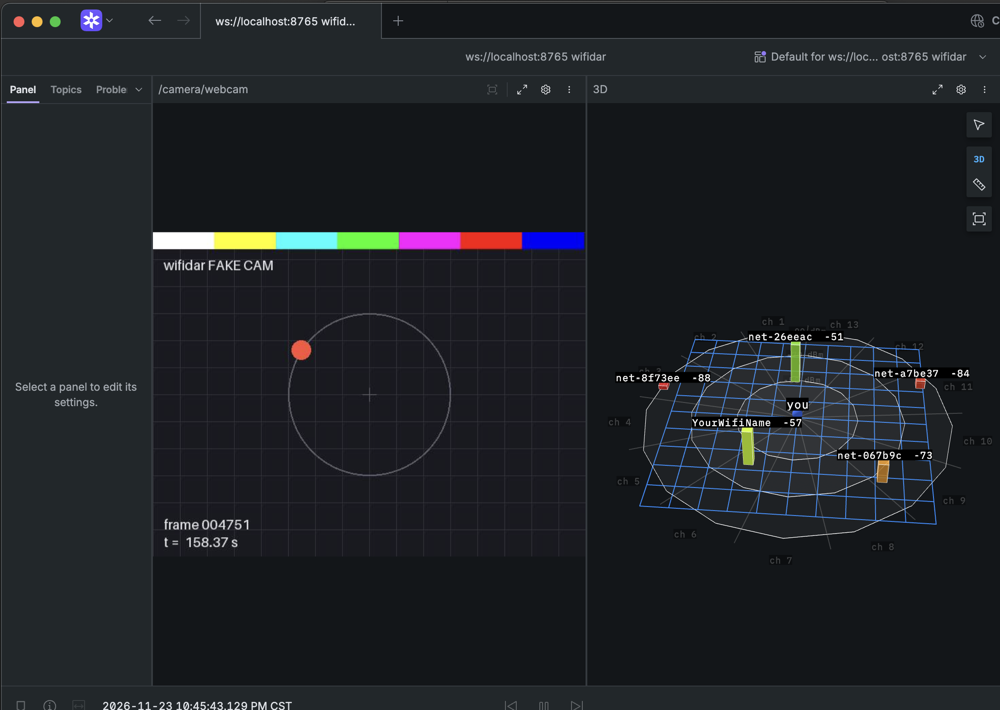
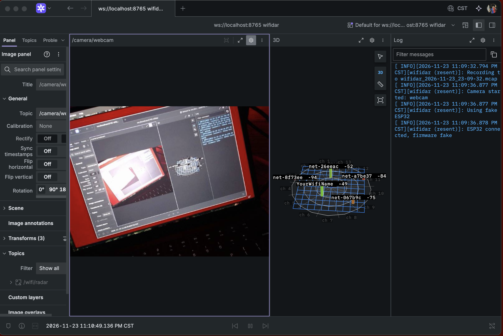

# wifidar

**Wi-Fi as a robot sensor, with Foxglove as two-way mission control.**

This is still in progress. I'm writing it as I go, so it covers how each idea actually came about, not just the finished thing.

---

## Where it started

I'd been looking into Foxglove, a tool robotics teams use to look at their robot's data. Camera feeds, lidar, GPS, motor readings, all lined up on one timeline so you can replay what happened and figure out why the robot did what it did.

I wanted to build something real on top of it. Not a tutorial, something that showed I actually understood how it works.

My first idea was pretty basic: an ESP32 sends its temperature to Foxglove and a custom panel shows it. Then I realized Foxglove's built-in Plot panel already does that. A custom panel that shows one number isn't really saying anything.

Next I looked at Foxglove's AI agent features, since I'd already built a physical approve/deny button for AI agents at a hackathon. But that needed a paid or academic plan, and I wanted something anyone could clone and run for free.

So the constraint was: free tools, hardware I already had, and something that actually uses Foxglove the way it's meant to be used.

## The idea

Robots see the world with sensors. One of the big ones is **lidar**, a spinning laser that measures how far away things are in every direction. Foxglove draws that in 3D so engineers can see what the robot saw.

I don't have a lidar. But I do have an ESP32 with a screen, and every ESP32 has a Wi-Fi radio that can hear every network nearby and measure how strong each one is.

So: **what if Wi-Fi was the sensor?**

Carry the ESP32 around, scan the networks, and Foxglove draws a live 3D radar of the Wi-Fi around you, the same way it would draw a robot's lidar.

Then the part I was most excited about: making it **two-way**. Most hobby projects only send data into a dashboard. Real robot tools also send commands back out. So I'm building a custom panel called **Signal Hunter**: click a network, Foxglove sends a command back down to the ESP32, and its screen turns into a hot/cold finder that fills up as you walk toward that router.

I called it **wifidar**, Wi-Fi + lidar/radar.

## Building without hardware first

The first thing I built wasn't for the ESP32 at all. It was a **fake ESP32** in Python.

The real ESP32 just sends lines of text over USB. So I wrote a fake one that sends the exact same lines, with signals that drift up and down like you're walking around. The program on my laptop (the bridge) can't tell the difference.

That meant I could build and test the whole laptop side before touching hardware. When the real board is ready, I swap one line.

## Thinking about privacy early

When I got data flowing into Foxglove, I realized something. A Wi-Fi scan picks up **everyone's** networks: my neighbors', random hotspots, all of it. And anything in Foxglove ends up in recordings and demo videos.

So the bridge hashes every network's hardware address into a short anonymous ID like `net-3fa2c1`, and only shows real names for networks I own. Each network still gets a consistent ID so the radar works, but nothing identifying about anyone else ever leaves my laptop.

## A bug that taught me how live data works

At one point Foxglove's Log panel was just empty. The bridge sends a "connected" message the second it starts, which was before Foxglove had connected. Live viewers only get messages sent *after* they start listening, so that message was gone.

The fix was a listener that notices when someone starts watching the log and resends recent events. Small bug, but it made the difference between live streaming and recording click for me.

## The radar

Each scan turns into a 3D radar in Foxglove. I'm the blue sphere in the middle, and each network is a bar around me:

- the **slice** of the circle it sits in is its Wi-Fi channel, so you can see which channels are crowded
- **closer** means a stronger signal
- **taller and greener** also means stronger, while short and red means weak

Getting there meant learning how robots describe space. Every shape lives in a coordinate frame, and a transform says how frames relate. Mine are just "the room" and "me" for now, but the same idea scales up to a robot with dozens of sensors.

## Recording everything

The bridge also records every session to an MCAP file, Foxglove's format for robot recordings. Open the file later and you get a timeline: drag it and every panel jumps to the same moment.

Along the way I found my log messages all claimed to be from **December 31, 1969**. Turns out an empty timestamp counts as zero, and zero in computer time is midnight on January 1, 1970 in UTC, which is 6 PM the night before in Central time.

## Adding a camera

This idea came from just looking around my desk. I had a Logitech webcam sitting there, and I started thinking about how real robots are set up. They don't only log numbers. They put cameras right next to the sensors, so when something weird shows up in the data, you can see what was actually happening.

Foxglove already lines up every topic by time. So with a camera, scrubbing through a recording shows the radar, the graphs, and what the camera saw, all from the same moment. Like seeing exactly where I was standing when a signal spiked.

### Faking the camera

I wanted to test the camera the same way I tested the ESP32: with a fake first. My idea was a fixed, standard test image at a set size, where only a few things change each frame: a counter, a timestamp, and a dot moving slowly in a circle.

Because it's predictable, frame 120 always looks the same. If frames drop or lag, I'd see it right away instead of guessing. It's a way to test what a real camera setup would be like before the real camera is involved.

Then I switched to the real webcam with one flag. The first thing I did was point it at my own laptop with Foxglove open, so the camera feed shows Foxglove showing the camera feed, forever.

### Doing the math on the screen

Next I want one more view: **what the ESP32's screen was showing** at each moment. My first plan was to send the actual display buffer from the ESP32. Then I did the numbers:

- the screen is 240 x 240 pixels at 2 bytes each, so about **115 KB per frame**
- the serial connection moves about **11.5 KB per second**
- so one frame would take around **10 seconds**

Not happening.

Instead, the bridge can build a **digital twin** of the screen. Everything the screen shows (the mode, the signal strength, the network name) is data the bridge already has. So it redraws the same screen in Python and sends that to Foxglove. No extra data over the cable, it works with the fake ESP32 too, and it always matches the real thing.

## What's next

- the screen twin
- the Signal Hunter panel and two-way commands
- firmware on the real ESP32
- a real walk around the building, recorded and replayable

I'll keep updating this as I go.
